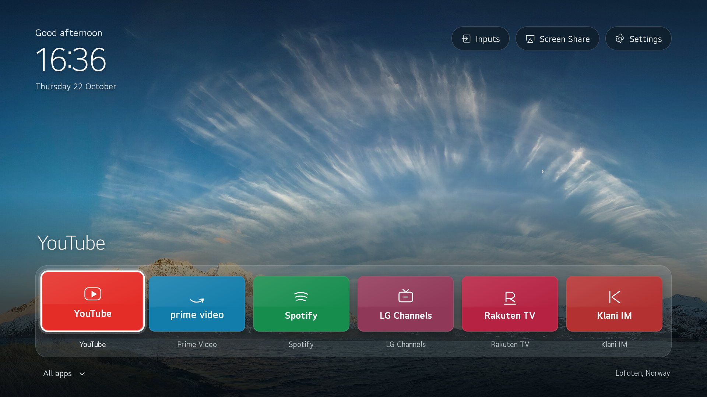

# MyOwnTV

<p align="center">
  
</p>

<p align="center">
  
  
  
  
  
  
</p>

A quiet, standalone home app for an LG 49NANO816NA on firmware 04.64.00 and webOS SDK 5.6.2. Six favorite apps, a configured app library, and rotating nature photographs. No ads, analytics, external fonts, feeds, or network requests in the launcher.

This is an **ordinary `.ipk` developer app**. LG Home, settings, inputs, tuner, AirPlay, Screen Share, voice/ThinQ, updates, LG Content Store, and every existing app remain available. The remote's Home button continues to open LG Home. There is no root, system-package change, factory menu, boot hook, or Home interception.

## Start here: Developer Mode and installation

First activate LG's official Developer Mode app. Follow the [installation guide](docs/installation.md), starting with **Developer Mode on the TV**, before running PC commands. It covers account setup, pairing, generating the `.ipk`, installation, updates, verification and recovery.

For installation with Claude, Codex, Antigravity, Grok or another local agent, copy the [AI-agent installation prompt](docs/ai-install-prompt.md). The agent needs local terminal/network access; a chat-only assistant can guide the steps but cannot install on your LAN.

## Your apps and controls

The initial dock contains YouTube, Prime Video, Spotify, LG Channels, Rakuten TV, and Klani IM. Their actual webOS IDs were read from the target TV; existing apps are used without reinstallation. LG Content Store and Developer Mode appear in All apps alongside the other installed apps and native shortcuts.

Google Play Store and Android APKs do not run on webOS. LG Content Store remains the compatible TV app store. This project does not install a root-dependent store or promise removal of advertising inside streaming content.

- Left/Right: move between apps. Up: TV controls. Down from the dock: All apps.
- OK: open an app. Magic Remote pointer and click also work.
- Back: close a panel, return from All apps, then delegate to LG's native Back behavior.
- Home: native LG Home at all times. Find MyOwnTV in LG Home's app row. For a direct return from live TV, hold **0** to inspect Quick Access assignments, open MyOwnTV, then hold an unused number **1–8** and confirm registration. Hold that number to return. See [LG's Quick Access instructions](https://www.lg.com/es/soporte/guias-y-soluciones/television/webos-3-5-funcion-quick-access/). There is no automatic startup/default-Home replacement.
- Settings: edit favorites and dock order, change or pause wallpaper rotation, reduce motion, view photo credits, or open original TV settings.

## Build and preview

Use Node.js 22+ (tested with Node 24) and npm:

```powershell
npm ci
npm test
npm run package
npm run preview
```

Open `http://127.0.0.1:4173`. `npm run test:browser` checks keyboard navigation, the library, saved settings/dock order, 720p scaling, and external requests. Windows tests use Microsoft Edge by default; set `MYOWNTV_BROWSER` for another Chromium executable. On Linux, install Playwright Chromium with `npx playwright install chromium`.

The runtime targets Chromium 68, used by webOS 5. The package contains the bundled app, metadata, icons, local photos, and notices. PC tooling dependencies are not shipped to the TV. LG's official CLI bundles dependencies with outstanding npm advisories; see [toolchain notes](docs/toolchain.md). A package build is not proof of real-TV operation.

## Pair and install

The PC and TV must be on the same network. webOS uses SSH on **9922**, not ADB. Keep LG's official Developer Mode app installed, enable Dev Mode and Key Server, and enter its temporary passphrase locally. Never publish it.

```powershell
npx ares-setup-device -a myown-lg -i host=<TV_IP> -i port=9922 -i username=prisoner
npx ares-novacom -d myown-lg --getkey
npm run tv -- pair --host <TV_IP>
```

Accept the remote pairing prompt on the intended TV. The tool verifies the model and pins the local TLS certificate. Credentials stay in ignored `.local/`. Its unsigned permission manifest does not impersonate LG.

```powershell
.\build-and-install.ps1
```

The script runs tests, validates the IPK, takes a readable-state snapshot, checks model/firmware, records the deployment, and installs only `io.github.akeyblademaster.myowntv`. `-BuildOnly` builds without connecting. The output is `out/io.github.akeyblademaster.myowntv_0.1.1_all.ipk`, with SHA-256 and package manifests. Keep the exact installed package and `.local` snapshots.

The initial installer refuses replacement when MyOwnTV already exists. For a controlled update, open MyOwnTV on the TV and run `.\build-and-install.ps1 -Update`. This requires a retained, validated prior IPK and exports only this launcher's preferences after taking the new baseline. A missing or stale export stops installation. Developer Mode is temporary: use its **EXTEND** control before expiry. LG removes developer apps if Developer Mode expires and is disabled. Turning Developer Mode off does not preserve this launcher.

`node tools/inspect-app.mjs --name <unique-name> --assert-rendered` captures the **actual TV app viewport**, not native menus or other apps. `--export-preferences` saves this app's settings privately; `--launch-app <configured-id>` invokes an existing visible shortcut and verifies the resulting foreground app ID. The first app-viewport render exposed a webOS local-file CSP difference; allowing the bundled `file:` resources fixed it. Modern desktop file-origin checks alone did not reproduce that issue. See [verification](docs/verification.md).

## Privacy and recovery

The owner approved turning off ads/personalization, recommendations, and HbbTV while keeping other TV features. These changes use ordinary settings, with original values recorded first. There is no Android-style `pm disable-user` operation for this non-root webOS project. The [privacy plan](docs/privacy-plan.md) separates intended choices from verified changes.

This TV denies whole-screen capture through the permitted interfaces, and private settings cannot be exported from Developer Mode. Snapshots contain readable inventories and explicitly list unavailable fields. They are **not firmware images or backups of app login data/all settings**. Privacy-menu changes wait until original values can be recorded and verified. An ad-free launcher does not establish that LG telemetry has stopped.

Press the physical Home button to return to LG Home, or run:

```powershell
.\restore.ps1
```

The script verifies the snapshot, closes this app and opens native LG Home. It removes nothing and guesses no defaults. Manually changed privacy toggles must be returned to their recorded original values. Read [safety and restore](docs/safety-and-restore.md) for exact scope. No workflow can guarantee zero risk from proprietary firmware or hardware faults.

## Architecture and customization

| Location | Responsibility |
|---|---|
| `src/domain/` | Preferences, favorite order, deterministic navigation |
| `src/platform/` | Public webOS launch/exit and browser preview |
| `src/ui/` | Screen rendering, interactions, wallpaper lifecycle and artwork |
| `src/app.js` | Dependency composition and mounting the UI |
| `config/` | App catalog, photos, target and app identity |
| `tools/lib/` | Paired connection, official CLI wrapper, snapshots, IPK validation |
| `tests/` | State, navigation, package safety, browser flow |
| `.local/` | Private snapshots, keys, records and captures; never committed |

Add apps to `config/apps.json` using verified IDs from `npm run tv -- inventory`, then rebuild. Never add factory/test apps. A later store install requires adding its shortcut and rebuilding: this sandbox cannot enumerate system apps automatically. Changing favorites only changes MyOwnTV's local preferences. Wallpapers live in `assets/wallpapers`; retain the photo notices.

The two requested references were audited before implementation. [The analysis](docs/reference-analysis.md) covers architecture, recovery, Android-only operations, licensing and webOS decisions. [The full inventory](docs/reference-inventory.json) hashes all 836 reference files and states the review coverage.

Code: the repository's existing GPL-3.0 license. Photos: individual CC BY-SA licenses in [WALLPAPER-CREDITS.md](WALLPAPER-CREDITS.md). Shortcut marks are original artwork for app identification, not official provider logos. Not affiliated with LG, Apple, or streaming providers.
